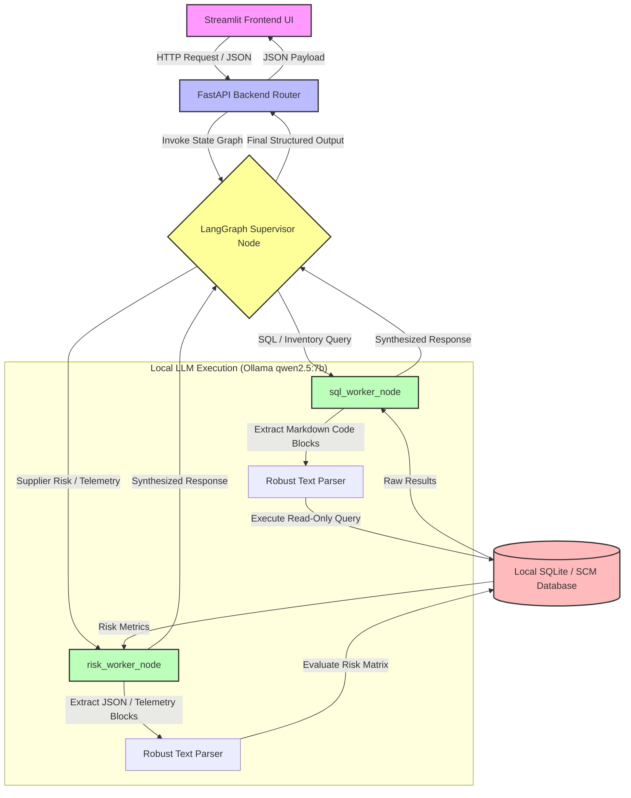

# Enterprise Multi-Agent SCM Platform

An enterprise-grade, locally orchestrated Multi-Agent Supply Chain Management (SCM) platform built with **FastAPI**, **Streamlit**, **LangGraph**, and **Ollama (`qwen2.5:7b`)**. Designed to run securely and efficiently on local hardware (optimized for Apple Silicon / 16GB MacBook Air environments) while maintaining robust, deterministic text-parsing and state management.

---

## 🏗️ System Architecture & Multi-Agent Workflow

The platform utilizes a **Supervisor-Worker pattern** managed via LangGraph. Incoming user queries from the Streamlit UI pass through the FastAPI backend to the central Supervisor, which dynamically routes tasks to specialized domain workers.



---

## 🛠️ Tech Stack & Components

* **Frontend:** Streamlit (Interactive conversational chat UI & SCM telemetry dashboards)
* **Backend:** FastAPI (Async REST API wrapper and state router)
* **Orchestration:** LangGraph & LangChain (Stateful multi-agent supervisor graph)
* **Local LLM Engine:** Ollama running `qwen2.5:7b` (Optimized for local token extraction and reasoning)
* **Parsing Engine:** Custom regex-based markdown block interceptors (` ```sql ... ``` `) to eliminate LLM JSON formatting errors.
* **CI/CD:** GitHub Actions (Automated multi-version Python compilation and `pytest` execution suite)

---

## 📁 Project Directory Structure

```text
supply-chain-agent/
├── .github/
│   └── workflows/
│       └── ci.yml             # Automated CI test pipeline
├── tests/
│   └── test_scm_core.py       # Core unit & integration test suite
├── .gitignore                 # Excludes .venv, cache, and local DBs
├── requirements.txt           # Python dependency declarations
├── README.md                  # Project documentation & architecture
└── ...                        # FastAPI, Streamlit, and LangGraph modules
```

---

## 🚀 Local Development Setup

### 1. Prerequisites
* Python 3.10 or 3.11 installed.
* [Ollama](https://ollama.com/) installed and running locally.
* Pull the local model:
  ```bash
  ollama pull qwen2.5:7b
  ```

### 2. Clone and Configure Virtual Environment
```bash
git clone https://github.com/ashishtople/supply-chain-agent.git
cd supply-chain-agent

python3 -m venv .venv
source .venv/bin/activate
pip install --upgrade pip
pip install -r requirements.txt
```

### 3. Run the Application
* **Start FastAPI Backend:**
  ```bash
  uvicorn app:app --reload --port 8000
  ```
* **Start Streamlit Frontend (in a separate terminal):**
  ```bash
  streamlit run ui_streamlit.py
  ```

---

## 🧪 Running Tests

To run the automated test suite locally:
```bash
pytest -v
```

---

## 🛡️ CI/CD Pipeline

This repository includes continuous integration configured via GitHub Actions (`.github/workflows/ci.yml`). Every push to `main` automatically triggers:
1. Multi-version Python environment validation (Python 3.10 & 3.11).
2. Dependency installation and Ruff code linting.
3. Automated execution of the `pytest` test suite.

---

## 📄 License
Distributed under the MIT License. See `LICENSE` for more information.